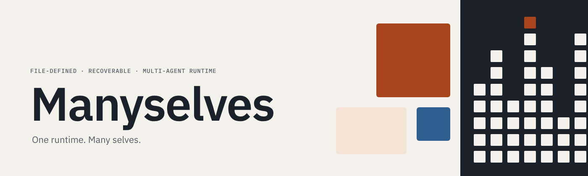
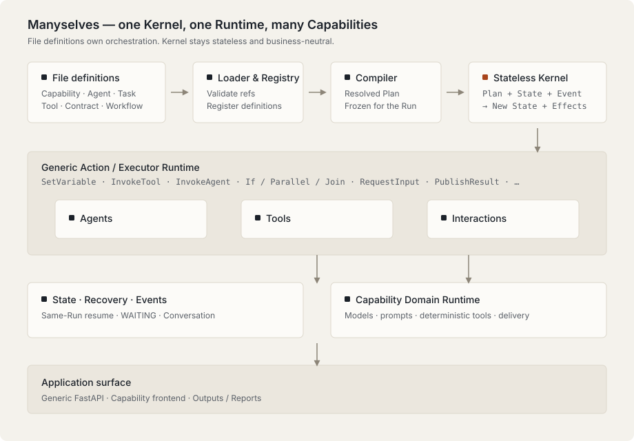

<div align="center">



### One runtime. Many selves.

**用文件定义智能体团队、可恢复的本地多智能体运行时；内置一套配电安全评估报告能力**

[](#)
[](https://www.python.org/)
[](https://nodejs.org/)
[](LICENSE)

[English](README.md) | 中文

</div>

## 理念

Manyselves 的出发点是：**智能体团队的分工应该写在文件里，而不是再写一个专用程序。**

换一套身份、技能、任务和流程定义，同一个运行时就成了另一支团队。运行时只管通用、持久的部分：对话、文件、调度、检查点、模型接入和产物。怎么分工、各角色做什么，写在能力包（Capability）的定义文件里。

> **One runtime. Many selves.**

---

## 设计原则

1. **文件定义**  
   智能体、任务、工具、数据契约、流程和恢复策略都用 Markdown / YAML / JSON Schema 声明，流程写在文件里，不藏在私有的 `if/for` 里。

2. **一个无状态内核，一套编译和执行语义**

   ```text
   Plan + State + Event  →  New State + Effects
   ```

   内核不认识模型供应商、报告章节或任何领域字段，能力包也不另造状态机。

3. **领域代码归能力包**  
   领域模型、确定性规则、提示词、工具、渲染和交付都放在能力包里，通用层只负责调度。

4. **结构归程序，判断归模型**  
   能由输入结构确定的事（分组、引用、核对、组稿）交给程序；需要专业判断的交给模型，程序只核对引用和结构。

5. **可恢复、可追溯**  
   同一次运行可以等待、中断后接着跑；对话、工具结果、事件和产物都落在磁盘上，可以回看。

6. **用户只跟 Main 说话**  
   后台的作者、审查、总编等角色在同一条时间线上协作，用户只在 Main 对话里说目标。

完整定位见 [`docs/PROJECT_POSITIONING.md`](docs/PROJECT_POSITIONING.md) 与 [`AGENTS.md`](AGENTS.md)。

---

## 系统形态



```text
Markdown / YAML / JSON Schema / Python 工具引用
                         │
                         ▼
                定义加载与注册（Registry）
                         │
                         ▼
                   流程编译（Compiler）
                         │
                         ▼
             冻结的执行计划 + 无状态内核
                         │
                         ▼
                 通用动作 / 执行运行时
                         │
          ┌──────────────┼──────────────┐
          ▼              ▼              ▼
        智能体          工具           交互
          │              │              │
          └──────────────┼──────────────┘
                         ▼
               状态 / 恢复 / 事件
                         │
                         ▼
          FastAPI / 能力包前端 / 输出文件
```

---

## 内置能力：配电安全评估报告

`distribution_reporting` 能力包从项目 `Inputs/` 里的评估表格、现场照片、知识库和报告模板，写出一份配电安全评估报告（Word 和来源索引）。它是这个运行时能承载什么的例子，不是运行时的边界。

### 一次完整报告怎么走

| # | 阶段 | 谁做 |
|---|---|---|
| 1 | 读表格，把格子整理成检查点记录、建证据索引；第二章的小节编号和标题只从评估信息汇总表读 | 程序 |
| 2 | 读照片：照片只佐证表格，同一读数以表格文字为准 | 模型（并行） |
| 3 | 判断台账：按组对每个检查点下判断，每行引用所依据的记录；资料缺口按类别由程序定 | 模型 + 程序 |
| 4 | 跨模块关联：作者提出关联，程序按结构分流和核对 | 模型 + 程序 |
| 5 | 审查：模块审查（含同栏同类行）和跨模块关联审查并行；有阻断意见才返修，轮间程序复查 | 模型 + 程序 |
| 6 | 台账定稿，生成主线、缺口条目，照片归到判断行 | 程序 |
| 7 | 写作：第二章各小节按台账一次写成；总编写第 3 章和第 1 章 | 模型（并行） |
| 8 | 联合审查：每个写手一份，只带它的小节、所写判断行、所引记录和落在这些行上的第 1、3 章条目，编辑和事实核对一次完成；判断行改动由程序带到所有引用处 | 模型 + 程序 |
| 9 | 对账、组稿、渲染 DOCX 和证据与来源索引 | 程序 |

第四章「专项问题分析」只看 `Inputs/` 里有没有对应的专项文件。资料不足的地方照实写资料不足，不编造。

### Main 能做的报告操作

| 你说什么 | 操作 |
|---|---|
| 用当前资料出一份新报告 | `full_report` |
| 改某一节、某个模块，或按更新后的资料修订 | `revise_report`：在原运行编号下出下一个版本，没受影响的部分原样复用 |
| 从报告模板重新提炼写作 Skill | `extract_skills`，确认后用 `publish_skills` 发布 |
| 把现有 Markdown 转成 Word | `render_existing` |
| 中断或失败的运行接着跑 | `resume_run` |

详细说法和参数见 [操作手册](docs/OPERATION_MANUAL.md)。

---

## 仓库内容

| 路径 | 内容 |
|---|---|
| `manyselves/kernel/` | 无状态内核：定义、契约、纯状态转换、端口 |
| `manyselves/runtime/` | 通用的智能体、工具、对话、交互、恢复、事件执行；模型接入 |
| `manyselves/definitions/` | 各能力包共用的标准定义库 |
| `manyselves/capabilities/` | 能力包：`distribution_reporting`（配电报告），以及用于验证通用链路的 `parameter_adjustment`、`checklist_review` |
| `manyselves/application/` | 通用的能力、流程、运行生命周期 |
| `manyselves/webapi/` | 通用 FastAPI 接口 |
| `manyselves/templates/` | 智能体身份与报告 Skill 文档 |
| `frontend/` | 配电报告产品前端（React），消费运行状态、事件和输出 |
| `frontend-contract/` | 前端使用的 OpenAPI 契约 |
| `desktop/` | Electron 外壳 |
| `deploy/`、`deployment/`、`scripts/` | Compose 部署、离线部署、启动与维护脚本 |
| `tests/` | 内核、运行时、能力包、接口与部署测试 |
| `docs/` | 操作、运行、配置、定位（[索引](docs/README.md)） |

---

## 快速开始

需要 Python 3.12+、[uv](https://docs.astral.sh/uv/)、Node.js 22+ 和至少一个模型供应商的 API 密钥。

```bash
git clone https://github.com/csxq0605/manyselves.git
cd manyselves
uv sync

cp manyselves.config.example.yaml manyselves.config.yaml
cp .env.example .env              # 改管理员密码；不要提交 .env

cd frontend && npm ci && npm run build -- --base / && cd ..
uv run python run_web.py --host 127.0.0.1 --port 9090 --data-dir <工作目录>
```

浏览器打开 <http://127.0.0.1:9090/>，用 `.env` 里的管理员账号登录，在模型设置里填供应商和密钥，然后在 Main 对话里说目标。

Linux/macOS 也可以直接 `./start.sh`（会按需构建前端）。Docker、多账户与服务部署见 [运行与部署](docs/RUNNING.md)，离线打包见 [离线部署](docs/OFFLINE_PACKAGING_REMOTE_DEPLOYMENT.md)。

---

## 文档

| 用途 | 文档 |
|---|---|
| 操作手册 | [docs/OPERATION_MANUAL.md](docs/OPERATION_MANUAL.md) |
| 本地运行 | [docs/RUN_LOCAL.md](docs/RUN_LOCAL.md) |
| 运行与部署（Docker、多账户、服务） | [docs/RUNNING.md](docs/RUNNING.md) |
| 离线打包与远程部署 | [docs/OFFLINE_PACKAGING_REMOTE_DEPLOYMENT.md](docs/OFFLINE_PACKAGING_REMOTE_DEPLOYMENT.md) |
| 配置 | [docs/CONFIGURATION.md](docs/CONFIGURATION.md) |
| 产品与架构定位 | [docs/PROJECT_POSITIONING.md](docs/PROJECT_POSITIONING.md) |
| 仓库约定（开发 / 智能体） | [AGENTS.md](AGENTS.md) |
| 文档索引 | [docs/README.md](docs/README.md) |

---

## License

MIT，见 [LICENSE](LICENSE)。
