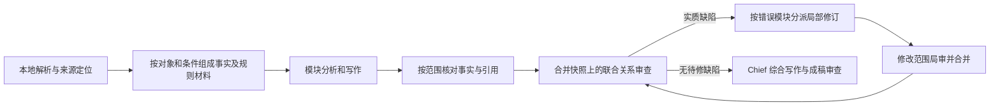

# 报告编排：成本、质量与来源的共同约束

2026-10-14 更新。状态：架构审计与分段实施中。Cross 建议分流、Chief/Final 来源材料去除静默截断、合并快照上的联合 Cross 已接线；来源引用闭环、联合审查的真实模型质量与完整报告验收仍未完成。

## 结论与可复现问题

瓶颈不只有上下文压缩。当前系统把同一内容交给多个角色重新理解，再用完整返工链处理这些角色的不一致；这会同时增加调用、失误机会和中断暴露。文件可读、结果符合 Schema、审查记录 completed，都不等于报告结论被来源支持。

| 生产位置 / 证据 | 设计缺口 | 应改变的职责或数据边界 |
| --- | --- | --- |
| `cross_owner_runtime.initial_has_findings`、owner pipeline；合成真模型曾在无事实冲突时生成 advisory | 建议和缺陷都走作者→局部 Auditor→Cross 复审 | 本次将可选建议保留为 deferred，只有实质缺陷返工；不把 deferred 记作 resolved |
| `cross_owner_runtime.prepare_recheck` 更新 owner，但 related refs 来自 initial frozen input；`reduce` 合并五路修订 | 每个 owner 与旧版同伴一致，不保证合并后的五模块一致 | 已改为以同一合并快照做联合关系审查，替换现有五条 owner 复审职责，不能再叠加第六层常驻审查 |
| Cross finding 只能归属于当前 owner；合成试验把相关模块的错误归责给正确模块 | 审查责任边界绑在写作章节，而不是错误所在处 | 联合审查按实际错误模块分派修改；正确章节不应为解释其他章节的错误被迫返工 |
| 五路 Cross 都能比较 owner 和四个 related | 存在 20 个有向模块比较入口，只有 10 个无向模块对；不同方向的关系仍可能有意义，不能简单宣称一半全是浪费 | 按观测对象和关系分组、每个关系只分配一个审查责任；保留关系两侧的条件，避免盲目按章节重复搜索 |
| `module_review_preparation._review_evidence` / `module_review_delta` 显式筛选 E-*；SourceLedger 另有 R-/W-* | 项目数据可见，不代表引用的规范原文、适用条件和例外可见 | 将“事实→判断依据→报告表述”分别绑定来源；按已知引用 ID 本地取原文/定位上下文，不能只给知识摘要或正确格式的引用 ID |
| `chief_runtime._source_projection` 与 `final_review_tools._source_projection` 原有 2400/6000/12000 字符截取 | 结构化材料被截成不完整 JSON，遗漏尾部关系/条件；工具能读不代表模型会补读 | 本次去除六处字符串切片，传递已按章节范围选择的完整材料；大范围自动分片仍待实施 |
| 真模型已出现正确抄出 16.58 和来源但规则判断错误，也有不同工况被误报冲突 | 既有推理错误，也有来源传递/任务定义错误；不能统称成一个“幻觉”问题 | 单独评测数值、适用条件、推理结论、引用支持；规则明确且被确认时可用确定性计算，未知适用条件必须保留不确定性 |

替换联合 Cross 前，完整 fresh full-report 在没有返工、没有复用时，五个模块作者、五个局部审查、五个 Cross、两个 Chief 和两个 Final 已有 **19 次 Agent invocation**；启用专题章节后为 **21 次**。这是任务层数，不是 API 请求数；每次 invocation 内仍可能多次读文件、写分段、纠错或压缩。章节并行不能消除 Module→Cross→Chief→Final 的阶段串行依赖。

## 已实施：Cross 建议不再强制返工

仅 Cross 生命周期改变。blocking 继续要求修改和复审；Module/Final 的既有处置语义没有随之改变。

- 仅 advisory：初审后结束 owner 分支，不修改模块。
- blocking 与 advisory 混合：只有 blocking 进入作者响应和复审合同。
- 复审新增 advisory：持久化但不开始下一轮；新 blocking 仍开始下一轮。
- Completion v3 分开记录 `resolved_finding_ids` 与 `deferred_advisory_ids`。既有 completion loader 同步检查：不能用 deferred 隐藏 blocking，也不能把同一建议同时记为 resolved。
- CrossDecisionPack v2 保留完整 deferred advice。Chief/Final 的来源列表包含该 pack，建议不被当成已经批准的事实或强制改写要求。它们可以按需读取；这不证明模型一定会采用或阅读建议。
- 原来已经进入返工的旧 checkpoint 仍保留当时 pending/response/verdict 语义，不批量改写历史结果。

真实 Generic Workflow Host 的脚本 Agent 测试对比：单轮仅建议分支由初审+作者+局审+Cross 复审 **4 次 invocation 变成 1 次**，确定减少 3 次派发；混合与复审新增建议场景仍完成原有 blocking 闭环。没有增加新的 Provider 调用、框架、锁或 Kernel 业务逻辑。该 75% 只适用于这条单轮建议分支，不是整份报告提速比例。

代价：模型若把实质错误误分为 advisory，会失去自动返工机会。提示和合同已明确事实、风险、引用支持和必要接口缺陷不能降级；这仍需对误分率做语义评测，不能靠 Schema 证明安全。保存建议而不假称已解决，至少保留了可复查的证据。

## 已实施：保留 Chief/Final 来源材料尾部

去除两条生产投影各三处直接字符截取，不改变章节选择，不另外调用模型摘要。测试先以真实固定小节合同构造长材料，再复现 `JSONDecodeError: Unterminated string`；修复后，两个角色的模块限制、Cross 关系、专题要求共六种投影均能完整解析，并与原始 typed 内容逐项相等。

| 合成材料 | 原先可见字符 | 当前字符 | 增量 |
| --- | ---: | ---: | ---: |
| 一个模块的摘要元数据及未决问题 | 2,400 | 4,062 | +1,662 |
| 一条长 Cross 关系及末尾限制 | 6,000 | 7,311 | +1,311 |
| 专题要求及末尾适用条件 | 12,000 | 13,652 | +1,652 |

这是每个相关角色实际传入的字符增量，不是 tokenizer 或 API usage，不换算成 token。低于原上限的材料没有此项增量。无新增 Provider 轮次，但单轮输入增加；足够大的必需材料仍可能触发既有窗口限制，自动分片未完成。不能再以静默删除必需条件来维持短请求。

## 上一片修改的真实增量

比较 `d0eabff` 与 `d3a011a` 的局部复审。固定官方 Claude 路由、模型、输出上限、工具和三类虚构输入；各重复两次，组内顺序随机。baseline 也已使用任务上下文重建，不是最早的完整历史系统。使用真实准备/submit_result 边界，但 API 循环为脚本，不是完整报告流程。原始输入、回答、usage、时长在仓库外 `audit_manyselves/review_increment_ab.json`。

| 指标：6 个案例合计 | 修改前 | 修改后 |
| --- | ---: | ---: |
| 首次请求 input tokens | 32,458 | 38,932 |
| 包括纠错的 API 请求数 | 7 | 6 |
| 包括纠错的 input tokens | 41,101 | 38,932 |
| output tokens | 6,330 | 4,148 |
| 首次请求累计 API 秒数 | 23.44 | 23.05 |
| 包括纠错累计 API 秒数 | 33.11 | 23.05 |
| 预期 verdict | 6/6 | 6/6 |

补齐未变正文及规则材料的直接输入代价是 **+6,474 tokens / +19.9%**，平均每个案例约 +1,079。修改前一次提交遗漏 resolved 所需 evidence_refs，额外纠错用了 8,643 input、2,014 output、9.67 秒。这次纠错抵消了新版材料增量，但小样本不能证明新版稳定更便宜或更快。两组 verdict 都正确，也不能用它证明准确率提升。缓存计数均为零，未估算未核实的人民币/美元价格。

## 已接线：联合 Cross 替换五路重复审查

正式 tail 现在调用 `distribution-cross-joint-review`：一个关系审查员读取五模块共同快照，将问题分派给实际出错模块；作者修订及局部审查仍走并行分支，Join 后才再次调用同一联合审查员。YAML 拥有顺序、并行、循环和异常交互；Python ports 只投影和接受单步结果。原 owner 定义保留用于已冻结计划和复用作者/局部审核机制，不是新 fresh 报告中的额外审查层。

离线脚本通过真实 Generic Host 验证：无问题及仅建议各一次 Agent 派发；两个模块各自照旧值修改、把矛盾交换位置时，联合复审同时看到两个修订版，继续修订未解决项；复审新增其他模块问题会进入下一轮。最终 completion 绑定最后共同快照，后续 pack 保留本轮 synthesis 与可选建议。只有有待修问题的模块准备修订材料，未受影响模块不生成重复 owner 输入。

没有返工的最低任务数从 **19/21 降为 15/17 次 invocation**，少四次；不含准备、工具循环、纠错、摘要和重试。过去五个 Cross 可并行，因此调用数减少不等于墙钟耗时减少 80%。联合阅读也增加单次上下文，可能降低注意力或撞上窗口；没有真实模型对照就不能宣称提高正确率。

同一虚构正文的本地输入合同投影（UTF-8 JSON 解码后字符数；两组均没有 Claims，排除 system/tool schema、工具读取、历史与缓存）：

| 合成正文 | 旧五路合同累计字符 | 旧最大单次合同 | 联合单次合同 |
| --- | ---: | ---: | ---: |
| 短正文 | 19,856 | 4,188 | 4,073 |
| 正文重复 100 次以检验体积 | 85,790 | 29,136 | 70,007 |

长正文累计合同字符减少约 18.4%，单次峰值约为原来的 2.40 倍。重复文本不是代表性业务材料，不用此数值估算生产 token、准确率或金额。原始指标在仓库外 `audit_manyselves/joint_packet_metrics.json`；本切片未调用外部 API。

另修复联合提交边界的编号错配：复审 verdict 不再按列表顺序覆盖其明确的 finding_id。真实 submit_result 的逆序回答测试保留了第二项 open、第一项 resolved 的对应关系。新 finding 的运行时 ID 带联合轮次，避免已关闭旧编号被新问题复用。coverage 仍由运行时补齐，只表示合同范围，不能证明模型实际完成了全部语义检查。

复用现有 Main 例外处理、Provider session、结构化纠错与已完成结果恢复。现有协议将明确 accept_dispute 计入已闭环编号，但原始 escalate verdict 与例外决策保留；这不是事实已经被证明正确。异常处理、引用语义和中断率不能仅靠成功路径推断。

若联合材料超过窗口，按观测对象/关系分区，而非摘要掉数值、测点、时间、工况、方法、单位、规则版本或例外。不同条件下同值异结论允许成立。关键信息不得依赖模型从旧聊天记忆恢复。

检索采用两条路径：已知来源 ID/模块范围由本地索引直接提供，未知对象或超出范围的问题再按需搜索。当前项目已有索引/查询，不应把“没有向量 RAG”理解成“没有检索”，也不应为了名义 RAG 引入外部数据访问。必须把召回失败与“没有记录”分开。

压缩仍有用，但位置是任务内临时过程、已完成工具细节和旧尝试；权威事实、当前正文、未决问题、规则条件由持久材料重建。400K 是单次窗口；多轮累计 token 仍是每次重新输入之和。短任务可不做 LLM 摘要；长任务应按累计输入、缓存命中、摘要调用时间和实际遗忘率决定阈值，本次不调整生产上限或压缩比例。

## 统一验收方式

每个候选架构用相同资料、相同预期缺陷、相同模型设置重复测试，并分别报告：

1. 质量：原始数据覆盖、尾部异常、同对象不同条件、明确规则/例外、未读内容是否编造；事实值与结论分开计分。
2. 引用：ID 有效、定位可复现、原文支持、规则适用范围，四项分开；不能只统计脚注数量。
3. 审查：真缺陷召回、误报、建议误分、修复后再次引入错误、合并版本一致性。
4. 成本：所有角色及摘要/纠错/失败的 input、output、cache read/write 分桶；实际价格确认后再换算金额。
5. 时间：请求时长、工具时长、排队、阶段 critical path 和端到端 wall time 分开；不能把并行请求耗时相加冒充报告耗时。
6. 恢复：在事实准备、写作分段、Cross 修订和 Join 前中断，验证重复调用与丢失状态；普通成功测试不证明中断率降低。

只对合成资料进行外部 API 测试。客户报告完整质量、规范符合度、端到端耗时与恢复成本仍待约定环境验收。

## 参考依据

Anthropic 的 [Building effective agents](https://www.anthropic.com/engineering/building-effective-agents) 将固定工作流、并行拆分与 evaluator-optimizer 区分，并强调只有反馈能带来可测改善时，反复评价和修改才有价值；这支持删除没有改善证据的返工，不证明本仓库的收益。

其 [multi-agent research system](https://www.anthropic.com/engineering/multi-agent-research-system) 展示了适合并行研究的任务分工及成本取舍。报告中的强依赖关系不能直接套用独立研究任务的并行策略；本文关于最终快照和错误归责的结论来自本仓库调用链与合成实验。
