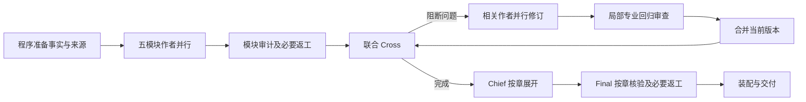

# PR #6 全清单首轮取证与实施依据

范围：[实施指导 S01–S06、Q01–Q07、F01–F04](../../implementation/PR6_REPORTING_IMPROVEMENT_GUIDE.md)。取证起点 `cfcd587`；首组改动为 `c44c390`（Q02）、`a858f16`（S02/S03）。本文保存这一轮的依据和设计结论；后续动态状态只更新 [RUNTIME_EXTRACTION_STATUS.md](../../implementation/RUNTIME_EXTRACTION_STATUS.md)。

可复跑脚本：[reporting_scope_audit.py](../../../scripts/benchmarks/reporting_scope_audit.py)；汇总结果：[reporting_pr6_evidence_audit.json](reporting_pr6_evidence_audit.json)。脚本读取仓库既有归档并运行合成请求构造，不初始化 Provider 客户端、不调用模型、不输出原始项目正文。执行：

```bash
PYTHONPATH=. .venv/bin/python scripts/benchmarks/reporting_scope_audit.py --output /tmp/reporting-scope-audit.json
```

## 1. 已有数据能说明什么

历史完整 Run `full-report-8c70828443b9499d80f8a6bda41c670c` 的分段汇总与原 runtime metrics 的请求及输入/输出总量相符，历史模型为 MiMo。它不是当前 PR 的耗时基准。

| 类型 | 请求 | 输入 token | 输出 token |
| --- | ---: | ---: | ---: |
| 普通 | 405 | 19,315,979 | 503,875 |
| 摘要 | 120 | 8,334,161 | 189,215 |
| 合计 | 525 | 27,650,140 | 693,090 |

历史证据支持同时检查审查、重复输入和摘要；不能据此认定输入成本次要，也不能把并行请求活跃时间求和当用户等待时间。逐 finding 原始记录不完整，无法从这些汇总恢复误报率、每条建议造成的返工成本或某个字段的 token 占比。

已有合成审查样本共 13 请求，可见正文合计 8,092 字符，submit_result 参数按紧凑 JSON 统一序列化后 7,940 字符。两者内容不完全相同，不能当成可直接删掉一半 token 的测量；它支持核查“先报告、再提交”的重复表达。

写作实验两批各 12 次流程、20 请求，共 40 请求。原始 untyped 文件保存的错误标签与后来修正的评分器存在差异：原记录三路零错误次数均为 0，而用仓库当前评分函数重算后分别为 4/4、3/4、4/4。脚本同时保留 recorded 与 rescored，避免混用分母和评分版本。仅针对“温升…55”的既有窄文本检查：

| 输入批次 | 直接写 | 写后审 | 先判断再写 |
| --- | ---: | ---: | ---: |
| 未显式标物理量 | 4/4 | 4/4 | 1/4 |
| 显式标物理量 | 1/4 | 1/4 | 0/4 |

这个检查不能证明没有其他错误。尤其判断优先的 typed 输出仍有“缺环境量→缺规则”的错误解释，因此不能用 0/4 温度混淆把它直接推广生产。记录中的小流程时间也不代表完整报告时间。

## 2. S01–S06：生产路径与负担

| 条目 | 本轮取证与处置 | 未完成边界 |
| --- | --- | --- |
| S01 审查返工 | `927aef5` 已使模块建议退出强制返工，阻断问题及原始意见保留。本轮不重复实现。历史 Cross 连带链 174 请求来自阶段归属。 | 缺乏逐意见因果记录，不能把174请求全算成浪费；局部专业审查与跨章关系审查职责仍不同。 |
| S02 Cross 综合 | 源码字段搜索表明五组独立明细主要作为整体 JSON 交给 Chief/Final，没有额外程序按这些字段制定行动。首组将15字段变10字段，合并原因/传播、行动依赖/协调、验证/验收；来源与边界不删。旧记录加载逐字保留明细；真正非空关系通过声明式 Cross、完成记录及恢复。 | 每轮仍按当前合并快照重新提交关系，不复用未经验证的旧关系。字段减少不是实测 token 节省；专业内容质量尚未重新生成验证。 |
| S03 重复提交 | 模块审计、联合 Cross、Final 提示已要求完成核查后直接结构化提交，不另写完整自然语言报告；必要查证和内部推理保留。 | 尚未测量模型遵循率；不做运行时截断，也不把必要纠错或查证回合算重复。 |
| S04 摘要 | **修正初始判断：** `TaskContextRebuilder.rebuild` 先对 system+任务历史做压缩，再加入精确任务状态。真实重建器探针保留295,000字符事实包及两版草稿，而两次送入历史压缩器都只有29字符；受影响测试验证大事实包不会逐轮触发摘要。 | 36K默认值约束这里的历史工作集，不等于事实包总预算；剩余关注写入历史在压缩之后才去重、长工具结果和任务边界。保留36K/0.6，不凭历史120次摘要直接提高阈值。 |
| S05 缓存 | 实际 Anthropic 序列化探针为 system cache marker=1、message cache marker=0。事实与草稿在同一 typed task capsule 中；逐稿变化主要在 user 状态。系统另含可变 task board，但它不必随每次草稿写入变化。 | 下一步应拆清稳定任务材料/动态草稿，并验证原生 Anthropic 与兼容端点序列化、工具配对和恢复；本轮未修改缓存策略，标记数量不是缓存命中率。 |
| S06 作者组织 | 当前2.4初写 Task确有16工具；模块初审和复审Task各11工具。默认单轮工具执行上限4。Claims还包含语义类型、可信度和未解决状态，不能只靠正文标记和来源绑定无损生成全部Claims。 | 未直接提高工具上限、删Claims或拆2.4；先核查已保存正文/绑定能替代哪些重复字段，区分写入次数、实际模型回合与合并后的质量责任。 |

## 3. Q01–Q07：历史缺陷到当前链路

| 条目 | 现有证据与本轮结论 | 下一步所需设计或证据 |
| --- | --- | --- |
| Q01 完整输入 | 既有 fact_packet_replay 的五模块记录数为31/97/16/126/46，共316；14条剩余电流、13测点、9条SPD记录进入包。关键词查询对这些范围的命中分别仅10、6、0；此前只按检索结果写作会漏项。这里复核的是归档回放结果，不冒充重读全部客户原表。 | 继续沿同一对象定位核对最终正文和行动。事实包完整只关闭“传递缺项”的一部分，不关闭“正文遗漏”。 |
| Q02 表格读取 | 六个合成反例覆盖两个入口、缺失/偏小/偏大 dimension。旧代码会整体 file_parse_failed。`c44c390`让两份工作簿均按真实单元格读取；缓存35、缺缓存G4、错误缓存G5及合并信息仍保留。 | 该尺寸声明缺陷已离线修复。第二个普通模式视图会增加内存；没有覆盖OCR、嵌套表格、所有专用映射器或过时但存在的公式缓存。 |
| Q03 数值与规则 | S4-4已区分测量温度、环境温度与温升，差值程序算一次，缺环境温度保持未知。评分重算证明显式类型有帮助，但不能代替正文检查。 | 计算输入至少绑定对象/测点、时间工况、quantity、单位、值、来源坐标；规则还需适用条件和原文依据。只在单位和适用条件明确时确定性比较，缺量、无可用规则、规则不适用分别表达。 |
| Q04 跨章一致 | 联合Cross已检查共同快照；局部批准和两边分别对齐旧版本仍不足。11.3A在一章出现另一章漏掉，是对象覆盖与语义同时出错。 | 比较键必须含观测对象/条件，而非只比数字或同一个ID。用同条件矛盾和不同条件合理差异成对验证；没有依据时不能靠共享账本传播一个确定结论。 |
| Q05 异常覆盖 | 当前预检查控制标记、来源ID重复和注册；Claims/E-ID有效不能证明全部原始异常都有正文和行动。 | 以原始来源坐标及对象建立预期异常集合，分别记录“已送达、被引用、已有判断、已有行动或明确待确认”；先输出差异用于核查，不把来源被引用当语义完成，也不默认新增阻断门禁。 |
| Q06 标准版本 | SourceRecord只有publisher/published_at/accessed_at/scope_note等一般元数据，无明确现行/废止状态、适用生效期、替代版本及其核验来源。published_at不能替代状态核验。 | 应保存可核验的版本状态来源与日期，未知保持未知；废止版本的历史背景引用与现行判定依据分开。尚无逐条标准的可信核验结果，本轮不猜填状态。 |
| Q07 Skill/选模 | 当前主要作者/审计/Cross/Chief定义均为model: inherit、profile: current-reporting；历史完整Run为MiMo，合成实验为Haiku。Skill已限制为方法资料，原始14份规则未全部语义验收。 | 核对具体运行的解析后模型配置与错误类型，再决定角色分配；不能把继承配置或某次实验模型当全部生产配置，也不能以更强模型替代缺失证据。 |

确定性质量设计沿既有 EvidenceMeasurement、来源账本、Claims、preflight 扩展；没有建立新运行时框架或专业判断门禁。自由正文的语义覆盖与规则适用性仍需要核验，不能只增一个结构化字段就宣布解决。

## 4. F01–F04：依赖与整体评估

当前主要依赖仍是：



- **F01：** Cross核查关系、局部审查核查专业回归、Chief写最终叙事、Final检查成稿保留上游语义。S02收敛的是交付表达，不假设这些责任已经可以全部合并。下一次阶段调整必须列出被删职责由谁承担及对应反例。
- **F02：** 判断优先原型有错误的缺规则解释。先把规则选择与缺测量的状态分清，离线检查输入到判断的可追溯性；暂不改为固定三个模型阶段。
- **F03：** 历史525请求、两个合成批次、审查样本、事实包回放与当前请求结构已放到一份可复跑汇总；每项标明历史/当前、字符/token、结构/语义。缺逐finding及完整当前成稿测量的部分明确保留，不要求先重跑才能分析。
- **F04：** 首组代码有77项受影响测试，另新增1项非空关系工作流测试通过。它们证明合同、恢复、材料传递和读取行为；S03实际输出减少、S05缓存收益、完整报告时间与专业质量仍未测量。

## 后续实施依赖

下一组先处理 S04/S05 的请求布局与压缩前后去重，使用当前真实序列化和恢复测试，不先调大阈值。同时落实 Q01/Q03/Q05 的“对象—观测—判断—正文/行动”离线差异样本，明确可以确定检查与仍需语义检查的边界。S06和F01/F02随后依据这两条线的结果决定；Q06/Q07各自需要版本核验和实际运行模型证据，不能被性能项挤掉。

本轮逐项取证覆盖整个清单，但不是17项全部完成。没有发出新Provider请求，没有重新生成完整报告，也没有承诺固定提速或费用比例。
