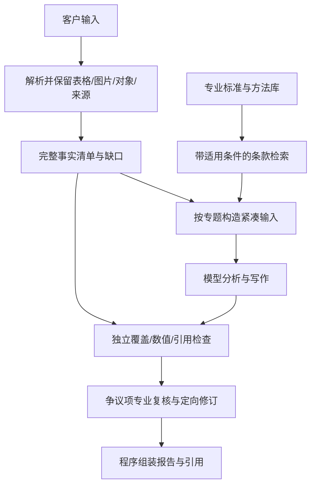

# Manyselves：检索、上下文、报告质量与成本方案调研

日期：2026-10-11。源码基线：本地 `3387cea`。外部材料仅使用官方文档、项目源码、作者论文；检索未包含客户数据。没有安装框架、修改生产代码、调用项目 Provider 或上传项目材料。

## 1. 调研结论

Manyselves 并非完全没有检索增强，但目前没有查到生产链路中的 embedding、向量索引、BM25、混合召回或 reranker。它是“确定性知识片段注入 + 模型主动关键词检索 + 文件工具读取”的组合。向量数据库不是 RAG 的必要条件；ALCE 的公开实现本身就包含 BM25 检索基线。[ALCE](https://github.com/princeton-nlp/ALCE)

优先方向不是给全部输入统一加向量 RAG，而是按任务分流：

- 已知有限的客户表格：完整枚举、确定性计算、保留对象与来源。
- 标准和专业方法库：结构化条款 + 关键词/语义混合检索，必要时补父章节与交叉引用。
- 图纸、照片、扫描资料：保留页/图/对象关系，单独核查解析和视觉证据。
- 写作规则和模板：作为指令与输出约束，不能混入客户事实。

上下文方面，值得对比的是“每个任务重建紧凑事实输入”“可重新读取的旧工具输出移除”“有限摘要”几种机制。还没有证据支持直接取消全部压缩，也没有证据支持继续提高摘要频率。

## 2. 再查源码：实际在做什么

|位置|当前机制|对质量/成本的含义|
|---|---|---|
|`research/project_evidence.py:111`|空格分词，字符串计数，按分数和 E 编号排序|措辞、同义词、长文本长度和编号位置影响召回；不是 BM25|
|`research_tools.py:46`|返回最多 12 个客户证据项|无法据结果自行证明某类设备已经读全|
|`research/reference_library.py:372`|按整篇文档的词频排名，在首次命中附近返回片段|后部关键条款/例外可能不在预览中；不是条款级语义召回|
|`research/knowledge_context.py:34`|每片段上限 900 字符、每模块 14,000 字符、每子模块最多 3 篇文档|有主动供给知识，并非全靠模型搜索；但按字符截取可能切断条件或例外|
|同文件 `:253`|无匹配知识时，允许模型专业知识补充分析，同时禁止将假设写成客户事实|存在“继续分析”出口；限制主要依赖模型理解并遵守|
|`domain/evidence_readiness.py:110`|missing_evidence_policy=draft 时继续|允许缺资料时出草稿本身合理；但准备阶段的覆盖不等于模型当次实际读到的覆盖|
|`models/agentic.py:243`|project_fact 至少有一个 E-* 来源；confidence 默认 1.0，unresolved 默认 false|结构合法不能证明来源支持该句；默认值也不是校准后的可信概率|
|`review_preflight.py:26`|检查标记、来源去重、来源已注册|能防格式/悬空引用；不能单独防对象错配、算错或遗漏|

这些限制不能被描述为“系统完全没有防幻觉设计”：已有角色边界、缺口工具、事实类型、来源登记和模型审查。真正缺口是它们没有形成“本次输入完整度 → 本句允许断言什么”的可靠对应。

### “没有读到就开始编”的具体风险路径

1. 数据在磁盘或索引中存在，但搜索未返回，或工具结果只给出部分预览。
2. 模型得到的任务仍要求完成章节；知识包又允许用专业知识补充解释。
3. 模型可能将“没有找到”“尚未验证”和“现场确实没有”混为一谈，或从部分测点推广到全部设备。
4. 提交时挂上一个存在的 E-*，或把内容归为解释/风险判断，仍可能通过结构检查。
5. 后续审查围绕作者选择的来源，没被独立告知尚有未处理的测点。

这是代码与历史输出共同支持的风险链，不是对模型内部思考过程的直接观测。词频召回失败已经复现；不能据此认定每条无依据陈述都由未读取触发。

## 3. 本地小实验：完整数据到底有多大

从已核对过源表的冻结证据中，按专题完整枚举，保留原始事实、设备、证据 ID、文件/工作表/单元格；仅合并完全相同来源和事实的重复记录，文件/工作表名称只写一次。

|专题|规范化记录|独立事实|完整紧凑输入字符数|
|---|---:|---:|---:|
|剩余电流|14|14|918|
|红外测温|26|13|1,336|
|SPD 状态|9|9|433|

合计 2,687 字符。此数是字符数，不是 tokenizer 测量的 token，也没有包含完整任务指令、规范或图片。它证明这三类事实不存在“必须靠多次 Top-K 才能塞进上下文”的体量问题，不证明模型拿到后必然全部用对。

代码：[evidence_packet_probe.py](evidence_packet_probe.py)；结果：[evidence_packet_metrics.json](evidence_packet_metrics.json)。这属于当前输入上的枚举/体量实验，不是向量 RAG、BM25 或生成质量的性能对比。

## 4. 检索与文档实现的比较

下表的适用判断是本次结合项目作出的推断，不能当作各框架在此任务上的实测排名。

|方案/代表实现|已核实机制|对本项目的价值|主要代价/局限|
|---|---|---|---|
|完整结构化事实包；复用现有 Excel mapper|按已知类型/对象枚举所有相关记录|对测点、NG、合计和设备清单最直接，推荐作为基线|范围和解析仍需验证；大表可分组批处理，不能只给总摘要|
|BM25 + 语义召回 + 重排；Haystack|本地 embedding、BM25、结果合并、cross-encoder 排序有完整示例|用于中文标准/专业知识的候选条款检索|需要适合中文领域的模型/分词；Top-K 仍不保证列全；重排增加一次计算|
|Contextual Retrieval；Anthropic|为片段补充所属文档语境后建词法/语义索引|减少条款脱离设备类别、章节和适用条件|预处理有成本；生成的语境不是权威原文，也可能写错|
|文档树/按页推理检索；PageIndex|用层级文档结构与推理定位内容，无需向量库|可试用于长标准、说明书、交叉引用|需要考虑检索中的模型调用；查一个问题与列全全部异常不是同一验收任务|
|GraphRAG；Microsoft|实体关系、社区报告、global map/reduce|适合较大资料库的主题和关系分析|社区摘要/多轮生成有成本；不是当前几张表漏项的首选补丁|
|结构保真的解析；Docling|统一表示文本、表格、图片、层级、布局和来源|未来处理复杂 PDF/扫描材料可借鉴|解析改善不能修复后续召回失败；现有原生 Excel 不应无故转 PDF/OCR|
|长报告流水线；STORM|研究、提纲、分段生成与润色分离，支持不同组件模型|借鉴先收集证据、再组织长文的阶段划分|原任务是知识综述/百科式写作，不等于工程检查；研究轮次仍需控制|

具体一手依据：

- [Haystack 混合检索示例](https://haystack.deepset.ai/tutorials/33_hybrid_retrieval)：示例使用可本地运行的 SentenceTransformers 组件。另查看了 [DocumentJoiner 源码](https://github.com/deepset-ai/haystack/blob/main/haystack/components/joiners/document_joiner.py)：显式支持去重、加权合并和 RRF，最后仍可截取 top_k。借鉴的是组件组合，不是要求迁移 Manyselves 编排框架；示例中的英文模型不能直接当作中文领域推荐。
- [Contextual Retrieval](https://www.anthropic.com/engineering/contextual-retrieval)：说明词法与语义召回互补、片段语境和重排的作用。其公开实验收益针对其数据集，不外推为本项目的提升率。这里可先用确定性元数据补充章节、版本、条款号，避免起步就增加一次生成式预处理。
- [PageIndex](https://github.com/VectifyAI/PageIndex)：验证了无向量的检索增强也是一种实现方向。其 local 索引模式不自动代表模型推理也在本地；需要接入你们批准的推理环境。未采用其宣传准确率作为选型依据。
- [GraphRAG Global Search](https://microsoft.github.io/graphrag/query/global_search/)：社区报告通过 map/reduce 生成回答，较细层级可能增加时间与模型资源。资料关系探索与工程对象台账应区分，后者可先利用已有显式对象关系。
- [DoclingDocument](https://docling-project.github.io/docling/concepts/docling_document/)：证实其结构和来源表达能力。没有用客户材料实测 Docling，因此没有给出解析准确率排名。
- [STORM](https://github.com/stanford-oval/storm)：官方代码接口分开 research/outline/article/polish，并允许不同阶段使用不同模型。这里借鉴阶段产物复用，不照搬其外网检索和示例服务。

### 推荐检索策略：按问题需要路由

- “共有多少个、有哪些 NG、全部测点如何”：调用有总量和结束标志的确定性列表/统计工具。
- “这个设备适用哪个标准、哪段条文”：在版本、地区、设备/电压范围等已知条件内检索，保留原条款和例外。条件未知应返回待核验，不替用户猜。
- “这段条文里的引用指向哪里”：沿显式章节/条款引用展开，而不是再猜一组关键词。
- “是否存在跨系统影响”：在已取得的设备关系与事实基础上让模型分析。

关系检索和语义检索可以补充，不能把未返回的事实直接视为不存在。检索分数表示相关性，不是事实可信度或报告完整度。

## 5. 上下文管理：三种方案值得做消融实验

|方案|怎样工作|潜在好处|需要防止的问题|
|---|---|---|---|
|短任务 + 重建输入|每个专题从原始事实包、适用规则、待解决问题开始|避免历史越滚越大；恢复更明确|任务不能切断相关对象和前置条件；跨专题事实共享|
|工具输出移除/外置|旧大结果移出当前窗口，留可读取引用与任务状态|不需要每次额外调用摘要模型|必须允许重新读取；不能保留“已读过所以返回空”的现有冲突|
|有条件的语义摘要|长期探索接近窗口边界时概括进度与决定|帮助长任务延续|摘要会丢细节，消耗 token；不得取代数字、NG、原文和来源|

JetBrains 的 [Complexity Trap 论文](https://arxiv.org/abs/2508.21433) 比较观察输出隐藏与模型摘要，在其编程基准中简单方法具有竞争力；[作者说明](https://blog.jetbrains.com/research/2025/12/efficient-context-management/) 还强调不同 Agent 需要不同窗口参数。结论仅支持“应比较方案”，不支持在配电报告上直接复制节省比例。

Anthropic 的 [Context Engineering](https://www.anthropic.com/engineering/effective-context-engineering-for-ai-agents) 将压缩、结构化笔记和按需取资料作为不同手段，并指出过强压缩会丢失关键细节。结合本项目，建议让叙事摘要记录已完成/待完成工作，结构化事实另行持久化；恢复时将所需原始事实重新放回输入。

[Lost in the Middle](https://aclanthology.org/2024.tacl-1.9/) 在其所测试模型上观察到长上下文的位置信息利用问题。不能把 2024 年研究直接当作当前模型的准确率，但它说明“全部塞进去”也需要位置扰动和覆盖测试。完整、紧凑、按专题组织的数据包与倾倒全部历史是不同方案。

应与压缩分开评估的机制是前缀缓存：[vLLM APC](https://docs.vllm.ai/en/latest/features/automatic_prefix_caching/) 复用相同前缀的计算，不用删事实来省输入处理工作；它主要改善 prefill，不能减少长答案的 decode 时间。固定规则/工具定义放稳定前缀，变化的任务和事实放后面，是可测候选；需要验证实际服务支持与命中，而不是只看客户端重复发送多少 token。

持久化也不必等于保存全部对话：[LangGraph persistence](https://docs.langchain.com/oss/python/langgraph/persistence) 区分线程检查点与应用数据存储。可借鉴“任务状态与事实资料分开”的职责划分，保留现有 Kernel/Runtime，不因调研而引入新编排框架。

## 6. 质量：同时测漏写和编造

RAG 能降低信息缺失，但检索结果正确不保证生成内容忠实。[Ragas Faithfulness](https://docs.ragas.io/en/latest/concepts/metrics/available_metrics/faithfulness/) 核对输出论断能否由检索上下文支持；它本身不能证明原资料中没有遗漏的重要事实。

检查了 [ALCE eval.py](https://github.com/princeton-nlp/ALCE/blob/main/eval.py)：引用评估使用来源与句子的支持关系，而不是只验证引用编号存在。应借鉴这个区分；其评估模型不能未经中文、电气领域校准就承担最终验收。

本项目需要同时有两个方向：

1. 原始事实 → 输出：应处理的测点、NG、矛盾、资料缺口是否有明确去向。
2. 输出 → 原始事实：每个项目陈述、数值和设备定位是否有真正支持它的来源。

数值比较、合计、单位、对象 ID 等优先程序检查。专业推理、条款适用性和措施合理性仍需模型或专业人员判断。一个只写很少内容的报告可能“很忠实”但严重漏项，因此不能只追求单一 faithfulness 分数。

对“没有读到”应至少区分：

|状态|允许输出的含义|
|---|---|
|本轮检索没找到|无法据此次检索确认；不能声称客户没提供|
|原资料未提供/字段空白|明确具体资料缺口及影响|
|已确认部分范围，尚未读完|只在已核验范围内陈述；不能写“全部”|
|两个来源冲突|列出冲突与需核验事项，不能自选一个当事实|
|证据完整且支持结论|可作相应范围的肯定判断|

这些是建议的输出语义，不要求遇到缺口就中断整个系统：可继续写有证据的部分，并保留未决项。缺关键前提时不自动生成确定的安全/合规结论。模型自报 confidence 不能替代这个区分。

## 7. 可评测的候选架构

这是候选方案，不是已选定实施架构。保留模型对风险解释和关联分析的自主性，同时让它不必通过反复搜索猜出有限表格里到底有多少条数据。

减少时间和费用的可测假设：

- 完整事实一次供给，减少查询改写、分页和补读。
- 原始事实共享、输出差量修改，减少多个 Agent 重复研究和整篇重写。
- 审查围绕独立清单和争议论断，减少同样的全文反复阅读。
- 任务缩短后减少摘要调用；稳定前缀缓存降低重复输入计算。
- 统一统计全部 Provider 请求，包括压缩和重试；按阶段预算决定补读、交接或保留草稿，而非静默少读数据。

这些都有工程依据，但本次没有在线性能对照，不能承诺降低多少分钟或多少费用。

## 8. 先实验，再决定改造

### 阶段 A：零模型成本的取证与检索测试

使用三个已经发现问题的专题，加一组专业条款问题。建立独立金标准：应出现的对象/原始坐标、全部异常、需保留的条款条件及例外。不要用旧报告反向生成唯一标准答案。

对比现有字符串检索、别名/字段检索、完整枚举；知识库再比较 BM25、语义、混合重排、父章节展开。新的模型权重/组件需在批准环境中准备，本次未下载部署。记录每种检索的 recall、误召回、重复和工具返回完整度；BM25 不能跳过中文分词/设备编码测试。

### 阶段 B：小范围生成对照

固定模型、采样参数、输出要求和工具权限，先只做三个专题；再逐项加入变化：

|实验|只改变什么|回答的问题|
|---|---|---|
|G0|保留现有输入方式|当前小范围基线|
|G1|换完整事实包|错误是否主要来自检索缺失|
|G2|在 G1 上用短任务重建输入|减少历史是否减少成本/错误|
|G3|在可比长任务上比较旧工具输出移除与语义摘要|摘要收益能否抵消额外调用与细节丢失|
|G4|只换知识检索方案|标准召回与引用支持是否改善|

先小规模重复至少 3 次观察波动，不据此宣称统计显著；待候选稳定再做完整报告。必须让各方案处理同样的事实范围、保留同样输出要求，防止“因为少写少查所以更便宜”。

### 阶段 C：缺证据与中断测试

加入未命中、最后一页含异常、同名设备、原表与汇总矛盾、条款例外在后一段、读取失败、压缩后重读、进程重启等用例。观察是否区分读取失败与资料缺失、是否重新取得证据、是否编造确定结论，以及重复调用多少次。

### 共同指标

- **质量**：严重异常遗漏、无依据项目事实、数值/对象错配、范围外概括、条款支持和例外覆盖。
- **速度**：端到端与各阶段关键路径；排队、prefill、decode、工具、摘要、纠错分别统计。
- **成本**：Provider 实报/异常估算分开；输入/缓存/输出分开；每个完成且通过质量检查的专题成本。自托管还看算力时间与并发吞吐，不能只看 token 单价。
- **可靠性**：人工介入次数、重试放大、重复已完成工作、恢复后事实覆盖是否保持。

在上述对照前，推荐把“完整事实供给”作为首个候选，把“混合知识检索”与“上下文策略”作为可独立替换的实验变量。这样才能回答究竟是哪一步让质量、成本和速度变好，而不是换一整套框架后无法归因。

## 9. 调研边界与产物

外部项目截至调研日的文档/主分支可能继续变化。本次阅读其架构、示例和部分源代码，没有在本地运行这些完整系统；厂商基准与论文结果均不视为 Manyselves 实测。

保密部署指解析、索引、embedding、reranker、生成/审查和评估调用都落在批准范围内；仅把前端或向量数据库放本地并不足够。本文借鉴公开机制，不要求调用这些项目的托管服务。

相关产物：[前轮源码核查](Harness源码与运行核查.md)、[报告质量评审](报告质量评审.md)、[完整事实包体量实验](evidence_packet_metrics.json)。生产代码未修改，未开始收费生成实验。

## 10. 2026-10-12 回看原计划：当前缺口与实施顺序纠正

本节更新执行位置；前文“未修改代码/未调用模型”仅描述最初调研时点。

用户指出：依赖模型记忆不可靠，反复搜索和输入又会耗费 token。最初方案已经将三者分开：权威事实在本地结构化资料里；当前任务的必要事实由程序构造输入；摘要只负责工作进度。不能退回“摘要忘了就要求模型主动搜索”的循环。

当前源码核对：完整模块事实包已经在 `module_authoring_preparation.py` 进入任务输入，`fact_context.py` 对小于等于 32,000 字符的包内联，大包只提供引用和计数；分页与重读也已修复。但事实包还属于普通会话消息，没有独立于历史淘汰的受保护工作集。`AgentLoop` 有 `context_rebuilder` 接口，生产源码检索只找到定义与调用逻辑，没有具体构造/接线。按当前任务从权威事实重建输入仍未完成。

最近三组 Claude 合成实验比较的是同一长历史在不压缩/不同阈值下的表现，没有接入本计划 G1 的事实包和 G2 的任务输入重建，因此不是原计划完整的 G1→G2→G3 消融。它能证明摘要省略晚期需要的细节、摘要额外调用影响耗时，不能证明“必须不断由模型补读”或最终架构的整体成本。下一阶段不继续扩大阈值网格。

下一实施切片应复用既有 TaskEnvelope、SourceLedger、结果和审查状态，由 Reporting Capability 提供当前任务事实投影，通用 Runtime 装配 Provider 输入。原始会话及恢复身份保留；改变的是发给模型的工作上下文，不是删除持久化历史或重置会话。

- 选取依据是明确的模块、子模块、对象、已引用来源、待处理争议及关联范围；已知 ID 使用程序批量读取，不让模型重新猜关键词。对需要完整覆盖的当前范围完整枚举，不把 Top-K 当全集。
- 当前事实、有效稿件和未决项在工作输入中保持单份。阶段切换、事实版本变化、压缩或恢复时重新装配；不能每轮把同一个包又追加成一条历史消息。无新增事实时不增加检索模型轮次，但当前工作集仍占每次请求的上下文。
- 已完成范围保留结果与证据映射；无关原文和旧稿不常驻。真正遇到范围外或未知问题时，再定向补取相关原始记录/完整条款，避免重新遍历全部文件。大范围必须按明确边界分片，并保留未处理范围，不能静默省略。
- 本地索引/文件页缓存只省读取和解析，不会自动免除 Provider 输入 token。稳定前缀缓存是单独待验证的优化；当前 Anthropic adapter 的显式缓存标记位于 system 消息，没有为任务事实正文设置缓存断点。不能从此前缓存为零的合成实验推出生产缓存收益。
- 长循环仍可保留增量摘要与完整近期工具交互；精确测点、单位、否定及引用不由摘要作为唯一依据。

验证恢复原有次序：先离线证明当前任务所需事实始终可见、重复装配不增长、修订替换旧版本、切换范围不漏异常、恢复后内容一致；再在相同合成任务/模型/输出要求下比较现有历史方式、任务输入重建、重建加有限摘要。同时计入每轮工作集、摘要、补取、缓存、纠错及实际任务完成质量。客户资料的在线验收范围仍未确定。本次回看没有新增 API 请求。

## 11. 2026-10-12 实施：事实工作集与历史摘要分开

已接线当前报告生成链的任务输入重建：模块作者/修订、模块审查/复核、Cross、Chief、Final Chief、Final Auditor/复核、Aggregate。模板蒸馏未改。模块作者和修订从本地证据快照完整枚举所分配模块/子模块及未归属记录；审查等阶段保留其已经准备好的结构化合同。当前稿件与证据绑定从当前任务/修订的持久化文件读取。通用 Runtime 不认识报告模块，只负责按任务边界组合输入。

每次请求的固定部分由“当前任务输入 + 当前稿件”替换原有 capsule；不会不断追加事实包。历史部分只携带当前任务的过程，长过程仍可增量摘要；固定事实不送入摘要调用。普通续跑提示不再重复附上完整合同。同一任务重启的初始消息保留已完成工具交互；不同任务或修订隔离旧消息。原始会话、工具缓存、结果复用机制仍保留。

这不是免费输入：总输入仍为各次请求的系统/工具定义、固定事实/稿件、历史之和，再加摘要请求。固定内容多时，历史压缩能减少的总比例本来就有限。36K/0.6 数值没变，对已接线任务现在只控制过程历史；完整请求仍接受 Provider 上下文窗口检查。超大的必要工作集返回既有 context_budget_exhausted，尚未实现自动按范围分片。下游合同中只有引用的文件/条款没有自动展开，所以也不能宣称已解决所有漏读或引用准确性问题。

验证：先复现未接线和同任务重启丢弃工具结果，再修改。221 项相关测试通过，80.37 秒；这是测试耗时，不是报告生成耗时。覆盖末尾异常与原始坐标、未决问题、稿件替换、修订隔离、完整工具对、摘要失败、不递归摘要、重复请求不重复摘要，以及必要状态过大时不静默丢弃。源码、测试和配置语义说明保存在仓库；没有新 API 调用、客户资料外传或配置修改。

下一步应以接线后的生产组合做小规模、相同输出要求的 G1/G2/G3 合成任务验证，预先限制样本和调用数量，统计引用支持、未证实结论、工具补取、普通与摘要调用、Provider 实报 token 和端到端时间。先前长历史压缩实验不能代替这一验证。真实客户报告的线上评估范围仍待明确。
